# October — Open the Doors: walkthrough

Branch `feature/october`. Nothing deployed. Screenshots in this folder were
taken from a production build (`next start`, port 3129, no Atlas, placeholder
Supabase), desktop 1280×800 and phone 390×844.

## The way in

**Discover** has a strip across the top — _From October_ — above the surface
that was already there. Discover itself is unchanged below it. `iamoctober.com`
serves Discover at `/`, so the strip is the first thing on the domain. The nav
gains a fourth place, **From October** (`/october/from`), which holds two doors.

| Phone                               | Desktop                               |
| ----------------------------------- | ------------------------------------- |
| 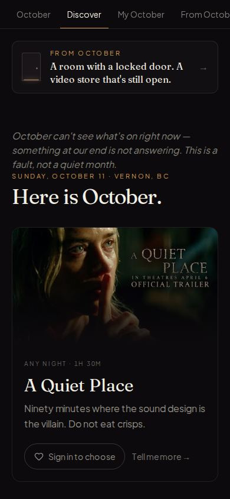 | 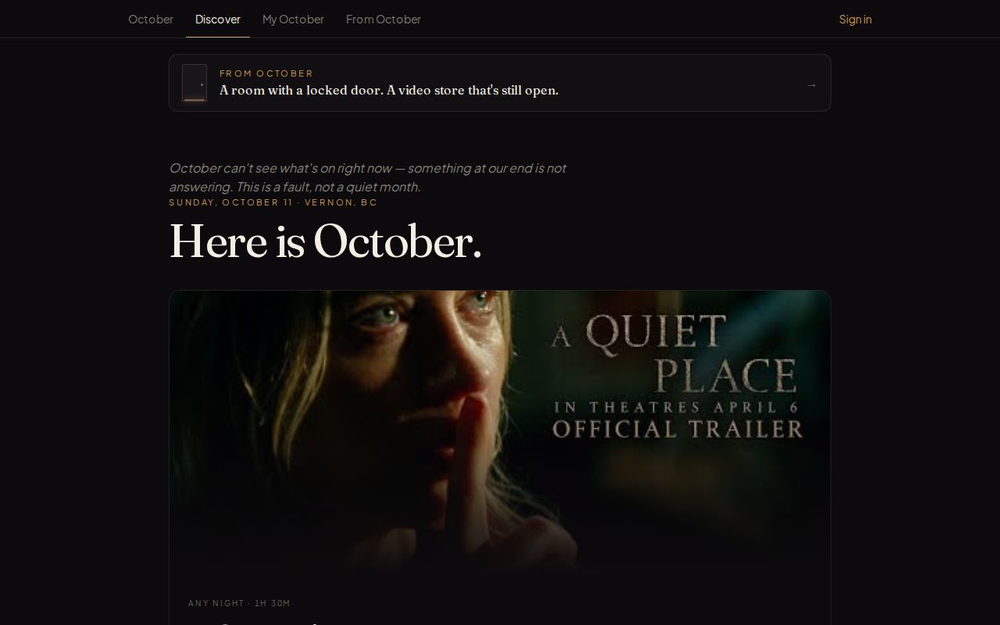 |
| 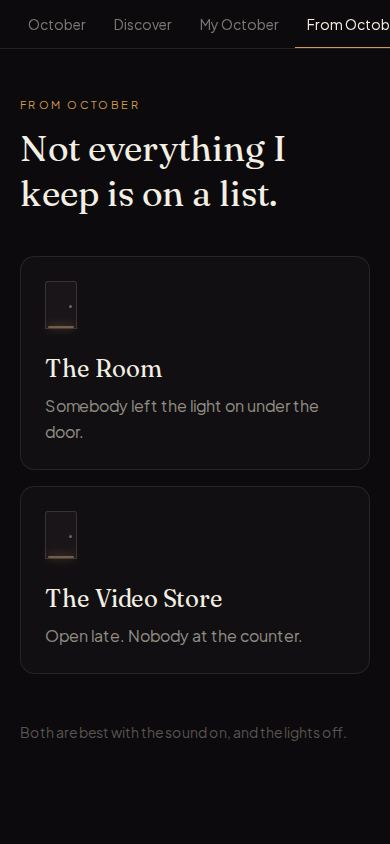             | 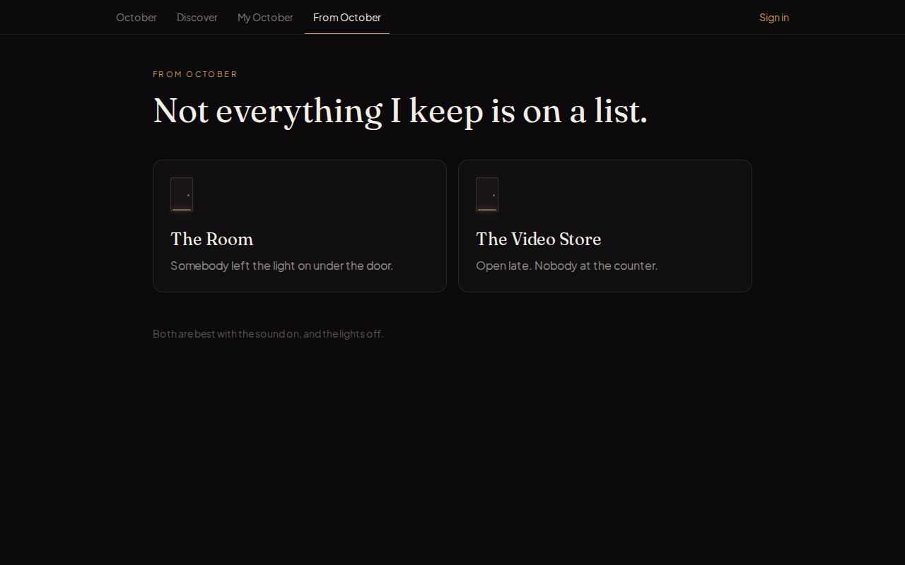             |

## The Secret Room — `/october/room`

You start inside it. One door, three wheels. The code is in the room, and the
room only tells you where if you find the radio.

1. **Find the radio** (it's warm). If you haven't touched it after 48 seconds
   October carries the light there and says _"You're not listening."_
2. **Tune it.** Three stations tell the truth and each asks a question of the
   room: _First. How many bars keep the moon out?_ (the window) · _Second. The
   clock stopped. What was the hour?_ (the clock) · _Third. Count what was taken
   from the wall._ (the pale rectangles where pictures hung). The radio keeps a
   list of what you have heard.
3. **October's own station** (106.9) is the clearest on the dial and it lies:
   _Seven. Seven. Seven. Trust me._ It's the only one that doesn't say
   First/Second/Third.
4. **The lock.** The answer is **4 · 7 · 2**. Enter 7-7-7 and October says
   _"Everyone believes that one."_ 3-1-0 gets _"No. Not that date."_ After a few
   wrong tries it starts to help, and eventually marks the wheels that are
   right.
5. **The door opens** — light fills it, _"You found the radio. Most people
   trust the other station. Go on."_ — and **Step through** leads to the Video
   Store.

Other ways October gets involved: the beam goes out once, around 24 seconds in
(_"Don't look at that one."_); the first time you hold the middle station for a
few seconds it takes the dial away (_"Hm. No."_); an idle room gets
_"Go on. Touch something."_

|                                      |                                   |
| ------------------------------------ | --------------------------------- |
| 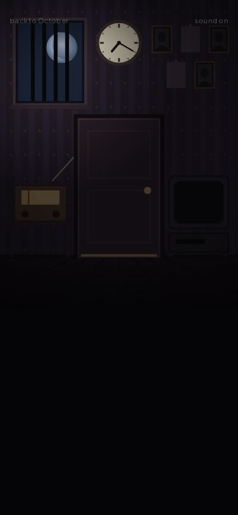          | 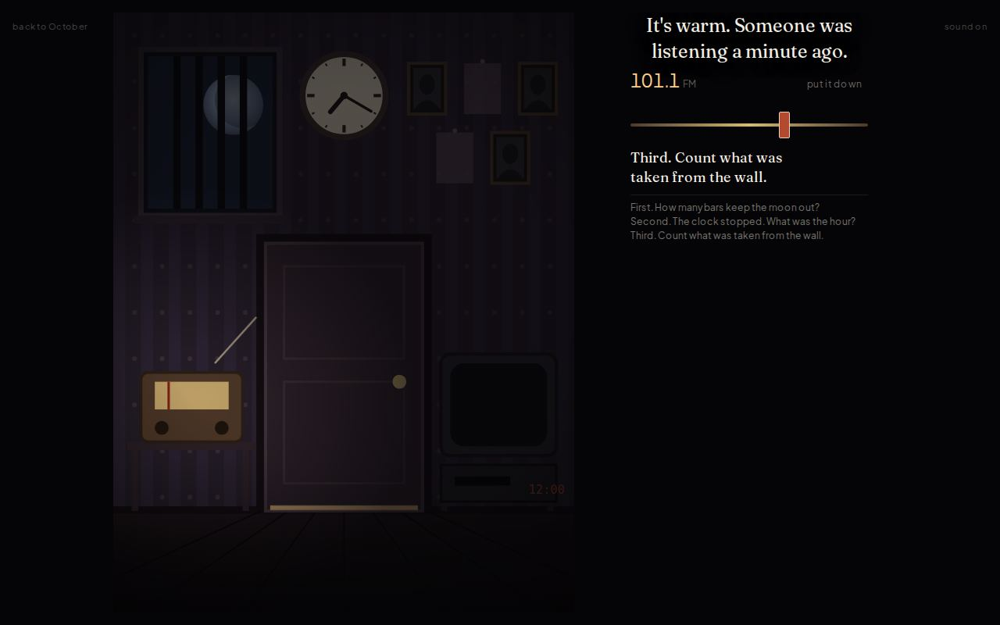 |
| 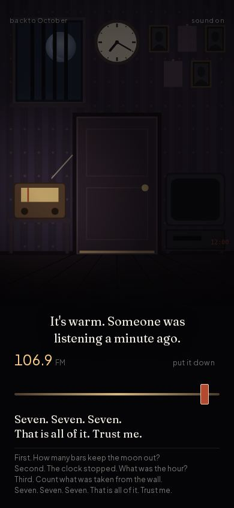 | 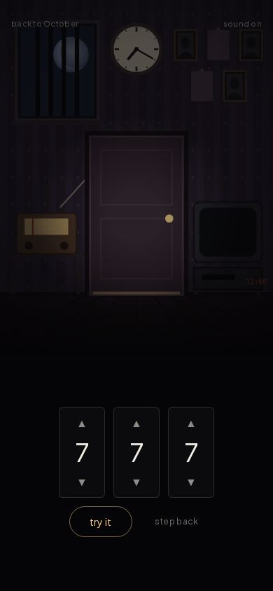  |
| 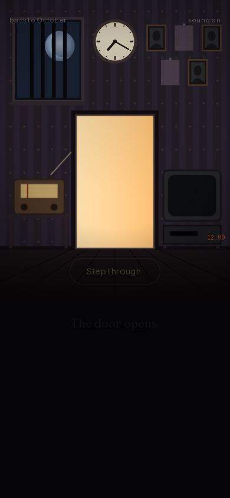         | 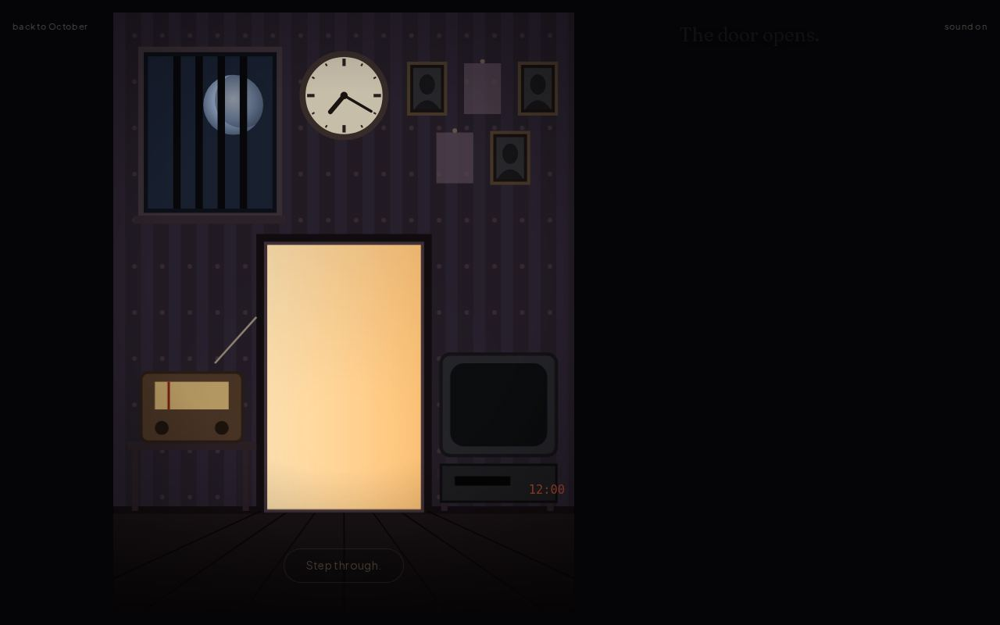    |

Sound is synthesised (room tone, radio static that clears as you approach a
station, wheel clicks, a thud for a wrong code, a bell when it opens) with the
recorded _Subterranean Pressure_ track very low underneath. The room works
muted: the radio's words are on screen, and there is a sound toggle.

## The Video Store — `/october/store`

Same wall as the lab, improved:

- **Phones can see it.** Held upright, the viewport shows a quarter of the
  wall. It now pans by dragging (a quiet "‹ drag ›" shows until you do), stops
  at the last tape, and squares up on whatever you pick up, then returns you.
- **The shelf is readable.** Sleeves were typeset at six pixels, which is where
  browsers stop positioning letters (`CASPER` rendered `CAS PER`). They are now
  typeset large and scaled down.
- **October refuses the obvious tape — once.** The first time you reach for
  _Ghostbusters_ it is taken back, and _The Lost Boys_ slides forward. (Before,
  this only happened with `?intervene=1`.)
- **The secret.** On the bottom shelf, left cabinet, is a black tape with no art
  and a strip of masking tape: _for whoever stays_. Turn it over:
  _tape 1 of 1 — play it where it was made._ Picking it up takes it — it
  leaves the shelf and a quiet _somewhere to play it_ link appears.

| Phone                                     | Desktop                                     |
| ----------------------------------------- | ------------------------------------------- |
| 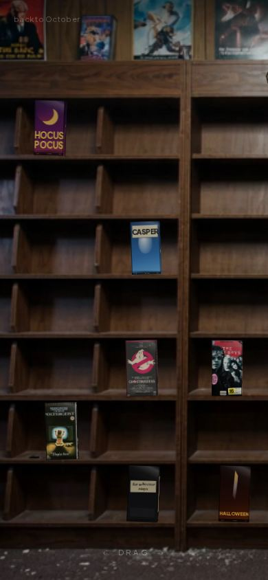        | 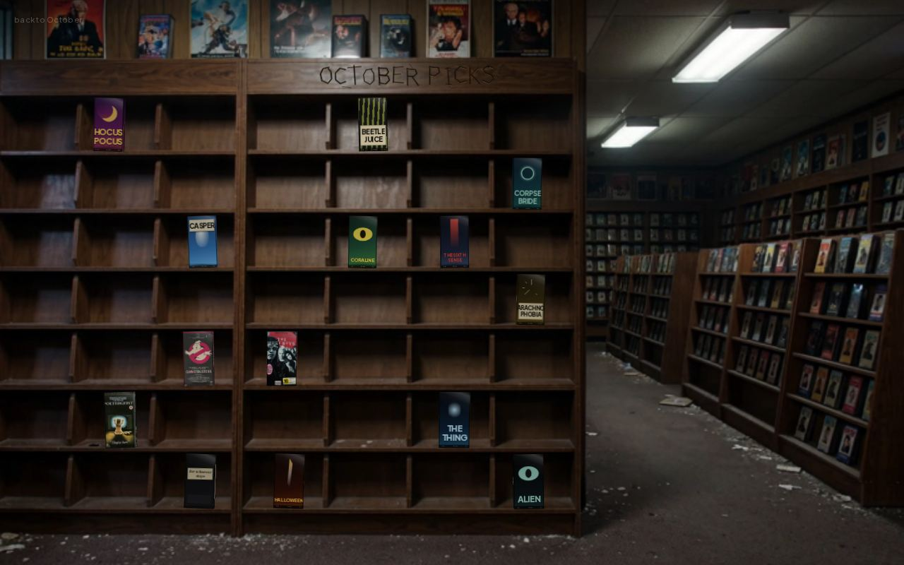        |
| 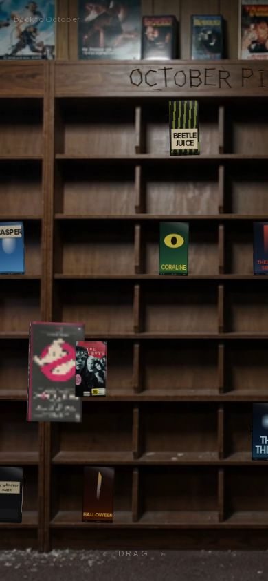       | 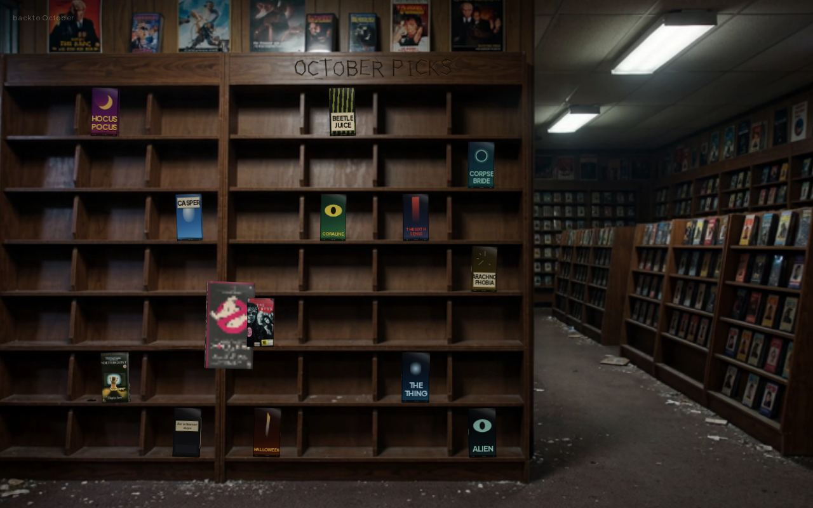       |
| 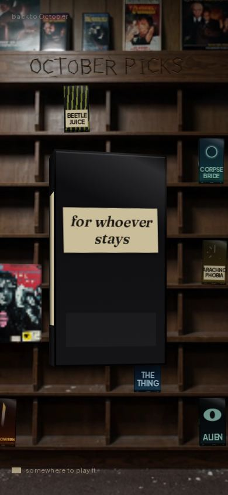 | 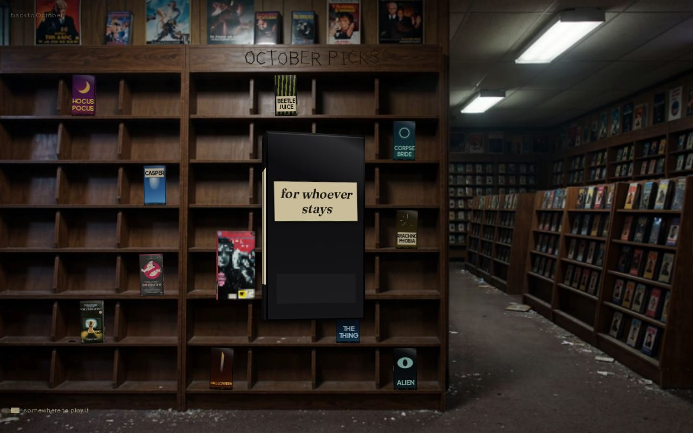 |
| 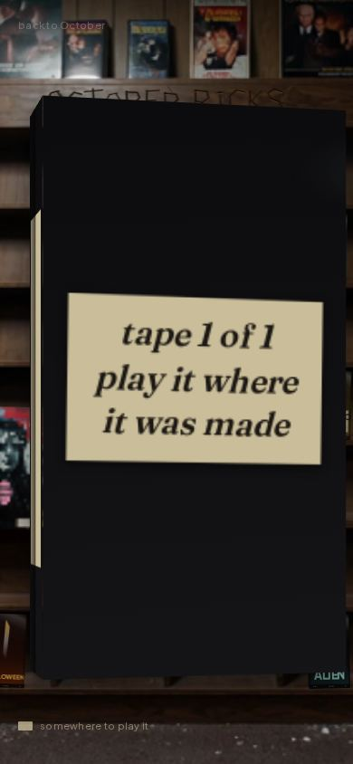  | 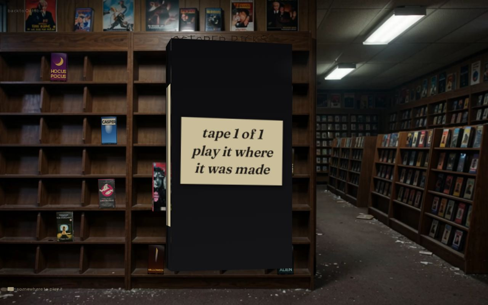  |

## What carries between them

`src/domain/october/passage.ts` — four timestamps in `localStorage`
(`tape`, `refused`, `escaped`, `played`). This browser only; no account.

- **Store → Room.** With the tape in your pocket, the room's video recorder says
  _"Not yet."_ until the door is open. Then you can play it: the room as the
  television remembers it, somebody sitting on the floor facing the door, and
  October — _"This is the last one who stayed. They were good at the radio. I
  kept the tape. I had nothing else of theirs."_ — then, after static,
  _"Thank you for taking it out of there. It was lonely on the bottom shelf."_
  Without the tape the video recorder says _"It wants something. Not from
  here."_
- **Room → Store.** Once you have been through the door, October stops
  refusing _Ghostbusters_ — and the card on its back reads _"Fine. You earned
  it."_
- **Everywhere.** The doors page and the Discover strip change what they say
  once you have been through.

|                                |                                       |
| ------------------------------ | ------------------------------------- |
| 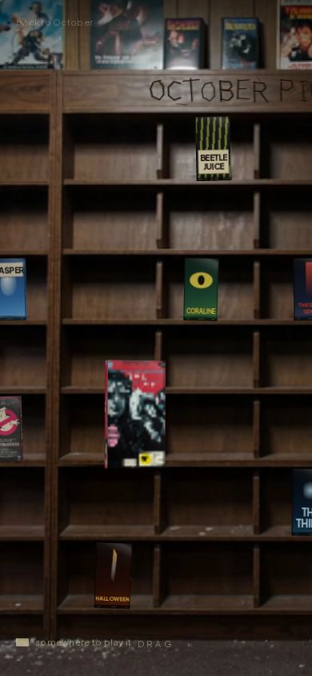 | 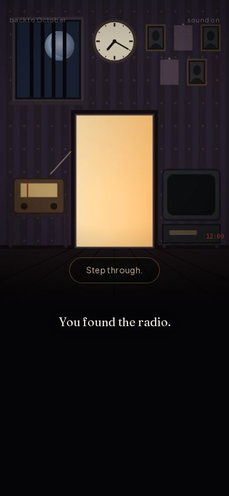 |
| 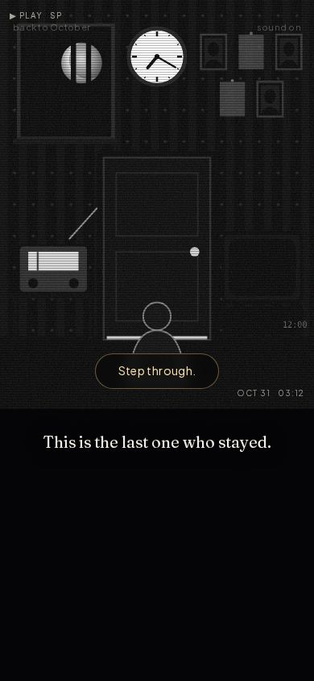   | 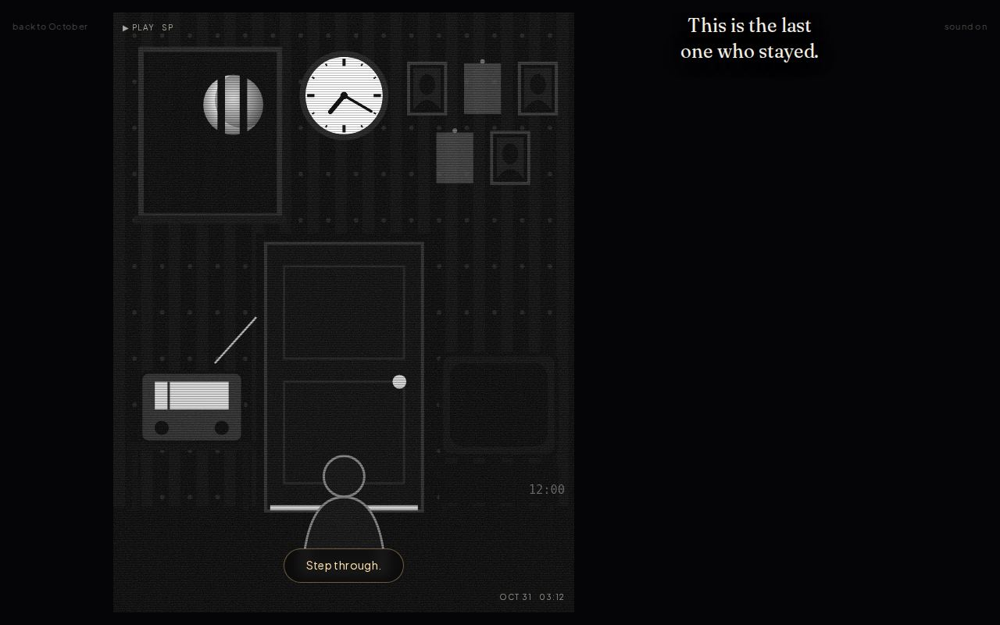        |

## The solution, in one place

Radio 89.7 → bars → **4**. 95.3 → clock hour → **7**. 101.1 → pictures taken →
**2**. Wheels **4 7 2**.

## Running it

```
NEXT_PUBLIC_SUPABASE_URL=http://127.0.0.1:9 NEXT_PUBLIC_SUPABASE_ANON_KEY=placeholder \
  npx next dev -p 3129 -H localhost
```

`/october/discover` → _From October_, or go straight to `/october/room` and
`/october/store`. To replay: clear `october:passage:v1` from localStorage.
`/october/store?intervene=1` always refuses the obvious tape.
